<!--
  Profile README for @TrishaAdio
  - Artwork in assets/ is generated from profile.config.json:  node scripts/build.mjs static
  - stats.svg and the contribution snake are rebuilt twice a day by .github/workflows/profile.yml
    and published to the `output` branch.
-->

<p align="center">
  
</p>

<p align="center">
  <a href="https://t.me/TrishaAdio"></a>
  <a href="https://github.com/TrishaAdio?tab=repositories"></a>
  
</p>

<br>

<picture>
  <source media="(prefers-color-scheme: dark)" srcset="assets/title-about-dark.svg">
  
</picture>

I build **Telegram bots** and the backend services that power them, tinker with **text-to-speech and small ML models**, and **self-host** whatever I can: reverse proxies, image hosts, the whole stack. Most of my repos run in production, not just on my laptop.

```python
from dataclasses import dataclass


@dataclass(frozen=True)
class TrishaAdio:
    role: str = "Backend & bot developer"
    speaks: tuple = ("Python", "JavaScript", "TypeScript")
    builds: tuple = ("Telegram bots", "TTS / ML models", "self-hosted services")
    side_quests: tuple = ("Minecraft mods", "3D web toys", "desktop apps")
    currently: str = "Shipping premium bots & scaling infra"

    def say_hi(self) -> str:
        return "Thanks for stopping by. Let's build something great!"


print(TrishaAdio().say_hi())
```

<br>

<picture>
  <source media="(prefers-color-scheme: dark)" srcset="assets/title-stack-dark.svg">
  
</picture>

<p align="center">
  <br>
  <br>
  
</p>

<br>

<picture>
  <source media="(prefers-color-scheme: dark)" srcset="assets/title-featured-dark.svg">
  
</picture>

<p align="center">
  <a href="https://github.com/TrishaAdio/Music"></a>
  <a href="https://github.com/TrishaAdio/channelguard"></a>
  <a href="https://github.com/TrishaAdio/TtsModel"></a>
  <a href="https://github.com/TrishaAdio/SiteDNA"></a>
  <a href="https://github.com/TrishaAdio/5seconds"></a>
  <a href="https://github.com/TrishaAdio/TrishaPlayer"></a>
</p>

<details>
<summary><b>More projects, by category</b></summary>
<br>

**Telegram bots & userbots**
- [NewEra](https://github.com/TrishaAdio/NewEraMusic): group-call music bot with a TypeScript control plane and a Go audio sidecar
- [QuickReply](https://github.com/TrishaAdio/quickreply): userbot for quick replies, away messages, payment logs and account backups
- [Saviour](https://github.com/TrishaAdio/Saviour): keeps a channel post pointing at a backup channel that's actually alive
- [Req](https://github.com/TrishaAdio/Req): welcomes every join request with your saved post, then broadcasts to that audience
- [Recycle](https://github.com/TrishaAdio/Recycle): anti-spam userbot that bans spammers and locks groups down on command
- [vidpack](https://github.com/TrishaAdio/vision): turns a video into a timeline, transcript and keyframe sheets a chat model can read
- [Aura Image Bot](https://github.com/TrishaAdio/Image): photo enhancement and effects, right inside Telegram
- [Emoji Pack Exporter](https://github.com/TrishaAdio/emoji): exports a whole custom emoji pack as AI-readable Markdown and JSON

**Minecraft**
- [Pegasus](https://github.com/TrishaAdio/Pegasus): tameable winged horses and unicorns for Java 1.21.1, with Paper and Fabric builds
- [Rasengan](https://github.com/TrishaAdio/Rasengan): server-authoritative charged energy sphere with a power-bar HUD
- [mc-builder-bots](https://github.com/TrishaAdio/Builder): a swarm of bots that builds the schematics you upload through Telegram

**Desktop & web**
- [CrystalChess](https://github.com/TrishaAdio/ChessSrc): glassy Windows chess client with Stockfish analysis, built on Tauri 2 and React 19
- [RuthlessChess](https://github.com/TrishaAdio/lola): full-strength Stockfish NNUE in the browser that never offers a draw
- [GlassPrint](https://github.com/TrishaAdio/printer): batch printing companion for Windows with a translucent glass UI
- [TileCraft](https://github.com/TrishaAdio/halftone): splits one image into paper tiles for a wall-sized poster, entirely in the browser
- [গ্যাসের অদৃশ্য জগৎ](https://github.com/TrishaAdio/gas): 3D, scroll-driven Bangla lessons on the gas laws for classes 8 to 12

**Tools, AI & infra**
- [kalam](https://github.com/TrishaAdio/illustrations): turns photos into pen-and-ink plates in the style of Satyajit Ray's illustrations
- [Shift](https://github.com/TrishaAdio/VpsShifter): moves bots, sites, APIs and databases to a new VPS, and rolls back if anything fails
- [kiro-runner](https://github.com/TrishaAdio/vpsmcp): config-driven runner that lets an AI agent use your VPS for installs, tests and builds
- [GitHub MCP](https://github.com/TrishaAdio/Github-Power): MCP server that lets an AI push code and open PRs while your token stays local
- [RioApis](https://github.com/TrishaAdio/api): OpenAI-compatible API on top of the Kiro CLI, with API keys and spend tracking
- [TrishaOS](https://github.com/TrishaAdio/TrishaOs): Yor Forger themed environment layer for Ubuntu 24.04
- [Anime Details API](https://github.com/TrishaAdio/anime): everything about an anime in one call, from open data sources

</details>

<br>

<picture>
  <source media="(prefers-color-scheme: dark)" srcset="assets/title-stats-dark.svg">
  
</picture>

<p align="center">
  
</p>

<picture>
  <source media="(prefers-color-scheme: dark)" srcset="https://raw.githubusercontent.com/TrishaAdio/TrishaAdio/output/github-contribution-grid-snake-dark.svg">
  
</picture>

<br>

<picture>
  <source media="(prefers-color-scheme: dark)" srcset="assets/title-connect-dark.svg">
  
</picture>

Telegram is the fastest way to reach me.

<p align="center">
  <a href="https://t.me/TrishaAdio"></a>
</p>

<p align="center">
  
</p>
